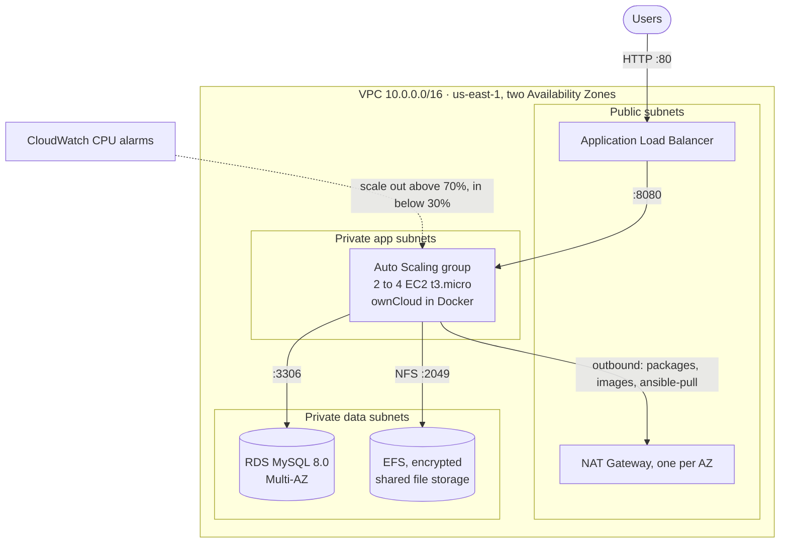

# ownCloud on AWS: High-Availability Deployment with OpenTofu and Ansible

A highly available ownCloud file-sharing platform on AWS, spread across two Availability Zones. OpenTofu builds the infrastructure. When each EC2 instance boots, it pulls its Ansible playbook from this repository and starts ownCloud in Docker.

**Stack:** AWS (VPC, NAT Gateway, Application Load Balancer, EC2 Auto Scaling, RDS MySQL Multi-AZ, EFS, CloudWatch) · OpenTofu · Ansible · Docker · ownCloud

Team project for the *Applied Cloud Computing* course, M.Eng. Software Engineering for Industrial Applications, Hochschule Hof (summer semester 2026). I built it with Nicolas Duarte ([@nicolasduarter](https://github.com/nicolasduarter)). Original repository: [nicolasduarter/acc-owncloud-project](https://github.com/nicolasduarter/acc-owncloud-project).

## Architecture



| Layer | Resource | Details |
| --- | --- | --- |
| Network | VPC with 6 subnets in us-east-1a and us-east-1b | Public subnets for the ALB and NAT gateways, private app subnets for EC2, private data subnets for RDS and EFS. Each AZ has its own NAT gateway and route table, so it keeps outbound access if the other AZ fails. |
| Load balancing | Application Load Balancer | HTTP on port 80, forwarding to a target group on port 8080, with a health check on `/status.php` |
| Compute | EC2 Auto Scaling group | 2 to 4 × t3.micro, Amazon Linux 2023, 20 GB gp3. CloudWatch alarms add an instance above 70 % CPU and remove one below 30 %. |
| Database | RDS MySQL 8.0 | db.t3.micro with a Multi-AZ standby, utf8mb4, 7-day backups, not publicly accessible |
| Storage | EFS | Encrypted, one mount target per AZ, access point owned by UID/GID 33 (www-data) |
| Security | Chained security groups | Internet → ALB (80/443) → app (8080) → RDS (3306) and EFS (2049). Nothing else can reach the data tier. |
| Configuration | Ansible via `ansible-pull` | Roles `docker`, `efs_mount` and `owncloud_container` |

### How an instance configures itself

1. The launch template's user data installs Ansible and Git.
2. It writes the instance's settings (EFS IDs, RDS address, credentials, ALB DNS name) to `/tmp/extra-vars.yml`.
3. It runs `ansible-pull` against this repository's `ansible/site.yml`:
   - **docker:** installs Docker and `amazon-efs-utils`
   - **efs_mount:** mounts EFS at `/mnt/efs` over TLS through the access point
   - **owncloud_container:** runs `owncloud/server` with RDS as the database, EFS as the data directory, and the ALB DNS name and the instance IP as trusted domains

Every instance builds itself the same way and keeps no data locally, so the Auto Scaling group can add or replace instances at any time.

## Repository layout

```
tofu/      OpenTofu: VPC, subnets, NAT, ALB, Auto Scaling, RDS, EFS, security groups
ansible/   Playbook that each instance pulls and runs at boot
```

## Deploy

You need OpenTofu and AWS credentials (an AWS Academy Learner Lab, or your own account; see the notes below).

```bash
cd tofu
export TF_VAR_db_password='choose-a-strong-password'
export TF_VAR_owncloud_admin_password='choose-another-password'
tofu init
tofu plan
tofu apply
```

Open the `alb_dns_name` output in a browser and log in as `admin` with your admin password. The first boot takes several minutes while the instances install packages and start the container. The health-check grace period is 10 minutes.

## Destroy

```bash
tofu destroy
```

Run this as soon as you're done. Two NAT gateways, a Multi-AZ RDS instance and the load balancer are billed by the hour. `skip_final_snapshot = true` means the database is deleted without a snapshot.

## Running outside AWS Academy

Some values are hard-coded for the AWS Academy Learner Lab in us-east-1:

- **`LabInstanceProfile`** (in `tofu/ec2.tf`) is the IAM instance profile the Learner Lab provides. In your own account, create an instance profile and use its name.
- **`ami_id`** (in `tofu/variables.tf`) defaults to an Amazon Linux 2023 AMI in us-east-1. AMI IDs differ per region and get replaced over time, so look up the current one for your region.
- **Region and AZs** (us-east-1, us-east-1a/b) are set in `tofu/main.tf` and `tofu/network.tf`.
- **`ansible-pull`** clones this repository without credentials, so the repository must stay public. If you fork it, change the URL in `tofu/ec2.tf`.

## My contributions: bugs I fixed

| Problem | Fix | Commit |
| --- | --- | --- |
| The ALB health check requested `/` and treated HTTP 400 as healthy, so instance health wasn't reported reliably. | Pointed the health check at ownCloud's `/status.php` and accepted only HTTP 200. | [f7d4d45](https://github.com/vishvam707/Owncloud-AWS/commit/f7d4d45) |
| ownCloud rejected requests from untrusted domains because `OWNCLOUD_TRUSTED_DOMAINS` was space-separated. | Changed the list to comma-separated (ALB DNS, instance IP, localhost). | [10eaf83](https://github.com/vishvam707/Owncloud-AWS/commit/10eaf83) |
| The user-data heredoc that writes `/tmp/extra-vars.yml` was unquoted. Bash would expand any `$` in the values, such as a password, and `set -u` would abort the script. | Quoted the heredoc delimiter (`<<'VARSEOF'`) so the values are written literally. | [a0ac360](https://github.com/vishvam707/Owncloud-AWS/commit/a0ac360) |
| Instances could launch before the EFS mount targets existed, so the EFS mount at boot could fail. | Made the launch template depend on both EFS mount targets. | [0ad02fb](https://github.com/vishvam707/Owncloud-AWS/commit/0ad02fb) |
| The app security group allows only specific outbound ports. | Added explicit outbound DNS rules (TCP and UDP 53). | [9118475](https://github.com/vishvam707/Owncloud-AWS/commit/9118475) |

I also wrote the initial VPC resource and the project's validation and test report (five test cases).

## What I'd improve next

- **HTTPS:** the ALB security group already allows 443. Add an ACM certificate and an HTTPS listener, and redirect HTTP to HTTPS.
- **Secrets:** the database and admin passwords pass through EC2 user data, which can be read from instance metadata. Store them in SSM Parameter Store or Secrets Manager and fetch them at boot.
- **Reproducible images:** pin `owncloud/server` to a specific version instead of `latest`.
- **State and CI:** keep OpenTofu state in S3 with locking, and run `tofu fmt`, `tofu validate`, tflint and Checkov on every push.
- **Cost:** add a single-NAT-gateway option for development environments.
